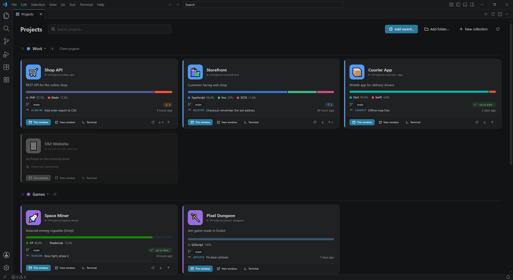

# Project Tiles

[](https://github.com/InvisibleF0x/project-tiles/releases/latest)
[](https://marketplace.visualstudio.com/items?itemName=dominikmech.project-tiles)
[](https://open-vsx.org/extension/dominikmech/project-tiles)
[](https://github.com/InvisibleF0x/project-tiles/actions/workflows/ci.yml)
[](LICENSE)
[](https://github.com/sponsors/InvisibleF0x)

A lightweight tile dashboard for your projects, in its own editor tab. Available for VS Code and its forks
(Positron, Cursor, Antigravity, VSCodium) and for JetBrains IDEs (PhpStorm, IntelliJ IDEA, WebStorm, …),
all sharing one project list.



## Features

- Tiles with **name, description, logo** (emoji or text, an image file, or an auto-detected `logo.png` / `icon.png`) and colour
- **Collections** with colours and descriptions; drag & drop to reorder projects and collections
- **Git branch and last commit** per repository, plus an **ahead/behind badge** (↓ to pull, ↑ to push, ✓ up to date);
  tiles refresh on their own after pull / commit / checkout
- **Languages** like on GitHub (weighted by bytes), with a manual override per project
  (e.g. `C#, ShaderLab` for a Unity project instead of whatever its YAML suggests)
- **Add current folder** in one click, with a form pre-filled from the open folder
- Search across names, descriptions, paths, languages and branches
- One `projects.json` shared by every editor and live-synced between open windows
- English and Polish UI

## Install

- **VS Code**: [Visual Studio Marketplace](https://marketplace.visualstudio.com/items?itemName=dominikmech.project-tiles), or search for *Project Tiles* in the Extensions view
- **Positron, Cursor, Antigravity, VSCodium**: [Open VSX](https://open-vsx.org/extension/dominikmech/project-tiles)
- **PhpStorm and other JetBrains IDEs** (2025.2+): *Settings | Plugins | Marketplace*, search for *Project Tiles*

## Usage

Open the dashboard from the tiles icon in the activity bar or with `Project Tiles: Open Dashboard`.
Click a tile to open the project in the current window; `Ctrl`+click (or *New window*) opens it in a new one.

| Command | What it does |
| --- | --- |
| `Project Tiles: Open Dashboard` | Opens the dashboard tab |
| `Project Tiles: Add Current Folder as Project` | Adds the open folder / workspace and opens the edit form |
| `Project Tiles: Add Folder as Project…` | Picks a folder from disk |
| `Project Tiles: Refresh Git & Language Info` | Forces a metadata refresh, including `git fetch` |
| `Project Tiles: Open Data File (projects.json)` | Opens the catalog for manual editing or backup |

Tip: bind `projectTiles.open` to a key, e.g. `Ctrl+Alt+P`.

## Settings

| Setting | Default | Meaning |
| --- | --- | --- |
| `projectTiles.openInNewWindow` | `false` | Open projects in a new window by default |
| `projectTiles.showOnStartup` | `false` | Open the dashboard when a window starts without a folder |
| `projectTiles.tileSize` | `normal` | `normal` or `compact` |
| `projectTiles.columns` | `3` | Preferred number of tile columns (fewer when the window is narrow) |
| `projectTiles.fetchRemote` | `true` | Run `git fetch` before computing ahead/behind; off = compare with the last local fetch only |
| `projectTiles.metadataCacheMinutes` | `10` | How long git info is reused before re-checking |
| `projectTiles.languageCacheHours` | `12` | How long a language scan is reused before re-scanning |
| `projectTiles.maxFilesScanned` | `15000` | Upper bound on files inspected per project for language detection |
| `projectTiles.languageIgnoreDirs` | `node_modules`, `Library`, `obj`, … | Directories skipped during language detection |

In JetBrains IDEs the same options are under *Settings | Tools | Project Tiles*.

## Data and privacy

The project list and imported logos are stored in one folder shared by every editor:

| OS | Folder |
| --- | --- |
| Windows | `%APPDATA%\project-tiles` |
| macOS | `~/Library/Application Support/project-tiles` |
| Linux | `$XDG_CONFIG_HOME/project-tiles` (default `~/.config/project-tiles`) |

No telemetry, no accounts. The only network traffic is `git fetch` in your own repositories, when the
dashboard opens and on manual refresh (turn it off with `projectTiles.fetchRemote`).

## How it stays light

- Activation only registers commands; nothing is scanned until the dashboard is opened.
- Git info comes from a few short `git` calls per repository, only when a `.git` entry exists.
- Language detection is a bounded breadth-first walk (depth and file-count limits, ignore list).
- Results are cached on disk, so tiles render instantly from the last known state while fresh data streams in.
- The dashboard is plain HTML/CSS/JS, no framework.

## Development

```
npm install
npm run watch      # rebuild on change, then press F5 in VS Code
npm test           # unit tests
npm run package    # typecheck + tests + bundle + .vsix
```

The JetBrains plugin lives in [`jetbrains/`](jetbrains/README.md) and reuses `media/` and `shared/`.

- `src/domain` – model and catalog rules (no `vscode` import, unit-tested)
- `src/services` – git, language detection, logo storage, metadata
- `src/storage` – JSON persistence and the shared data folder
- `src/webview` – webview panel and the typed message protocol
- `media` – dashboard page (also used by the JetBrains plugin)
- `shared` – UI strings and the language table, used by both editions

## Support

Project Tiles is free and open source. If it saves you time, you can
[buy me a coffee through GitHub Sponsors](https://github.com/sponsors/InvisibleF0x).

## License

[MIT](LICENSE) © Dominik Mech
